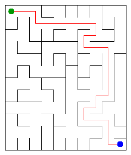

# Assignment 3. Maze Escape

Student ID: 254519
Name: Muratova Albina
Group: SE-2511
Maze size (rows x columns): 10 x 12

## Program output

The 13 lines printed by java -cp out Main on my data:

    Broken: 119
    Kept: 99
    Last broken wall: 179
    MST cost: 36487
    Heaviest broken wall: 795
    Path length: 26
    DFS visited: 50
    Dead ends: 38
    Zones: 11
    Largest zone: 17
    Is DAG: 0
    Flow stages: 8
    Fastest route cost: 16

My maze:

## Questions

### Mission 0. 
The find method returns the representative of the set containing an element. The union method joins two different sets and returns false if they are already connected. Path compression and union by size keep the trees shallow, making these operations very efficient.

### Mission 1.
The maze contains (R \times C) cells, and breaking a wall connects two previously separate components. A connected maze without cycles needs exactly (R \times C - 1) broken walls. The remaining walls are kept, so their number is ((R-1)(C-1)) for the given grid.

### Mission 2.
The MST cost from Kruskal is 36487, and Prim gives the same cost of 36487. Both algorithms find a minimum spanning tree with the minimum total edge weight, although they may select the edges in a different order.

### Mission 3.
There is exactly one path between any two cells because the maze produced by Mission 1 is a spanning tree: it is connected and has no cycles. I used iterative DFS with an explicit stack instead of recursive calls, preventing a stack overflow on a very large maze.

### Mission 4.
Kosaraju's algorithm uses the reversed graph in its second pass so that each traversal identifies one strongly connected component. When every zone contains exactly one cell, there are no cycles involving multiple distinct cells, so the directed graph is a DAG, assuming there are no self-loops.

### Mission 5.
The zone graph is a DAG, and its zone numbers give a topological order. Therefore, I can process zones in increasing order and update the cheapest route cost and the maximum number of zones along a route without using a priority queue.

## AI use

I used ChatGPT to explain algorithm concepts, review code, help identify errors, and understand the assignment requirements. I tested the implementation against the provided examples and used the explanations to study the code.

## Timing (Mission 7)

Measurements in milliseconds from java -cp out Bench, five runs per algorithm:

| maze | Kruskal | Prim |
|---|---------|------|
| 100 x 100 | 12      | 9    |
| 300 x 300 | 98      | 104  |
| 1000 x 1000 | 1497    | 2932 |

### What do the numbers say about how the time grows?
Both algorithms take more time as the maze gets larger. Prim is faster on the 100 × 100 maze, while Kruskal is faster on the 300 × 300 and 1000 × 1000 mazes in these measurements. The results are specific to this machine and run, and may vary with JVM warm-up and system load.

## Complexity

Let (n) be the number of cells, (m) the number of walls or slides, and (z) the number of zones.

| algorithm | time | space | assumptions |
|---|---|---|---|
| DSU find and union |Amortized (O(\alpha(n))) per operation |(O(n)) |Path compression and union by size |
| Kruskal |(O(m\log m))|(O(n+m)) |Sorting the walls dominates |
| Prim |(O(m\log m)) |(O(n+m)) |Adjacency lists and priority queue |
| DFS |(O(n+m)) |(O(n)) |Iterative DFS on the maze graph |
| Kosaraju |(O(n+m)) |(O(n+m)) |Two graph traversals using the original and reversed graphs |
| Route in the zone graph | O(z*n + m) |(O(n+m+z)) | Each zone scans all cells; slide adjacency is built once |

## Before you submit

- data/walls.txt, data/slides.txt and output/maze.png are in the repository.
- `java tools/Check.java` shows all examples right.
- This README is filled in, the program output and the section AI use included.
- The work is pushed to main (at least one commit per mission) and the repository is public.
- The link is attached in Moodle.
